<h1 align="center">Meta-Sezgisel Algoritmaların 0/1 Knapsack Problemi Üzerinde Karşılaştırılması</h1>

<p align="center">
  
  
  
  
  
</p>

<p align="center">
  <b>GA</b> · <b>ACO</b> · <b>Binary PSO</b> · <b>SA</b> &nbsp;+&nbsp; <b>GA-SA hibriti</b> (bonus)<br>
  aynı veri · aynı tohumlar · benzer değerlendirme bütçesi · gerçek optimum referansı
</p>

<p align="center">
  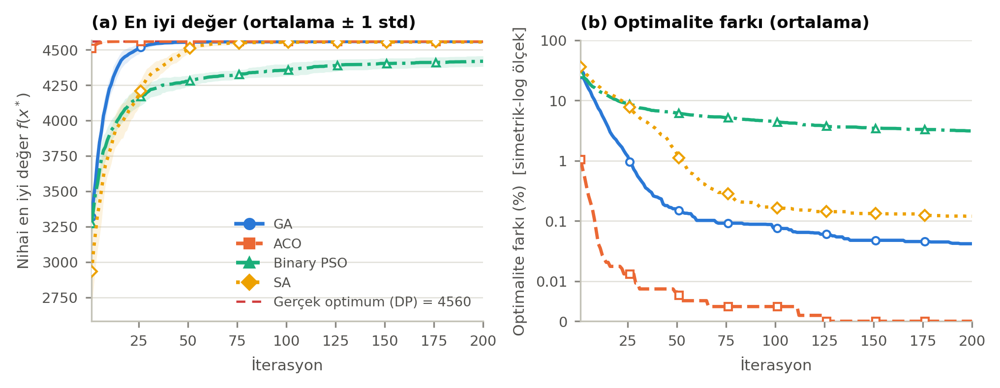<br>
  <sub>Dört algoritmanın ortalama yakınsaması (30 çalıştırma). Sağ panel: gerçek optimuma uzaklık (%), simetrik-log ölçek.</sub>
</p>

Dört meta-sezgisel algoritma **aynı** 100 ürünlü 0/1 Knapsack örneği üzerinde, **aynı** hesaplama bütçesi
ve **aynı** önceden tanımlı tohumlarla karşılaştırılır. Gerçek optimum, meta-sezgisellerden bağımsız olarak
**dinamik programlama** ile hesaplanır ve **MILP (HiGHS)** ile çapraz doğrulanır. Bonus olarak **GA-SA hibrit
(memetik)** yöntemi geliştirilmiştir.

> Tüm sayısal sonuçlar gerçek çalıştırmalardan gelir (`results/raw/*.csv`); raporlanan her değer
> `results/tables/*.csv` dosyalarından üretilir. Elle girilmiş sonuç yoktur.

## Bir bakışta

| | |
|---|---|
| **Problem** | `max Σ vᵢxᵢ` koşul `Σ wᵢxᵢ ≤ C`, `xᵢ ∈ {0,1}` |
| **Veri seti** | `data/dataset.csv` — 100 ürün (`item, weight, value`), toplam ağırlık 2724, toplam değer 5121 |
| **Kapasite** | `C = 0.70 · Σ wᵢ = 1906.8` (yuvarlama yapılmaz) |
| **Gerçek optimum** | **4560** (DP, MILP ile doğrulandı); oran-açgözlü sezgisel: 4552 |
| **Deney tasarımı** | 30 bağımsız tohum · 200 iterasyon · 40 birey/karınca/komşu · ≈8000 FE |
| **Adillik** | her nesne fonksiyonu değerlendirmesi sayılır; tam eşit bütçe ile de denetlendi |
| **İstatistik** | Friedman, Kruskal–Wallis, Wilcoxon, Mann–Whitney (Holm), Vargha–Delaney A₁₂, Cohen d |

## Mimari

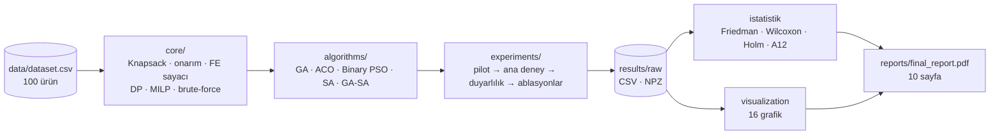

Tüm algoritmalar **aynı arayüzü** ve **aynı sayaçlı amaç fonksiyonunu** paylaşır; bu, adil karşılaştırmanın temelidir:

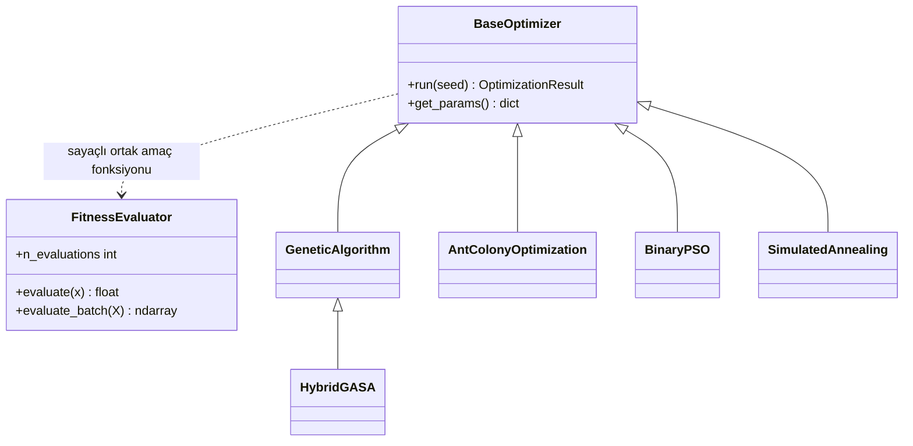

## Algoritmalar tek bakışta

| Algoritma | Temel fikir | Probleme özgü uyarlama |
|---|---|---|
| **GA** | Turnuva seçimi, tekdüze çaprazlama, bit-flip mutasyon, elitizm | Kapasiteyi aşan çocuklar ortak onarımdan geçer |
| **ACO** | Feromon **ürünlere** konur; karınca boş çantadan başlayıp sığan adaylardan olasılıkla ürün ekler | Sezgisel bilgi = değer/ağırlık oranı; çözüm uygun ve maksimal; MAX–MIN sınırları |
| **Binary PSO** | Hız denklemi sürekli PSO ile aynı; konum `rand < sigmoid(v)` ile örneklenir | Hız bitin 1 olma **olasılığını** belirler; v≈0 iken bit gürültüsü artar |
| **SA** | Metropolis: `P = min(1, e^(Δf/T))`, geometrik soğutma | Komşuluk: swap (çıkar–ekle) veya bit-flip |
| **GA-SA** *(bonus)* | GA küresel keşif yapar, SA en iyi bireyleri yerel iyileştirir | Nesil başı 28 GA + 12 SA = 40 değerlendirme |

## Sonuçlar

30 bağımsız çalıştırma; gerçek optimum = **4560**.

| Algoritma | Ortalama ± std | En iyi / en kötü | Optimumu bulma |
|---|---|---|---|
| **ACO** | 4560.00 ± 0.00 | 4560 / 4560 | **%100** |
| **GA** | 4558.10 ± 2.44 | 4560 / 4552 | %53 |
| **SA** | 4554.57 ± 7.01 | 4560 / 4523 | %6.7 |
| **Binary PSO** (w = 0.9) | 4418.17 ± 37.78 | 4499 / 4346 | %0 |
| *GA-SA hibriti (bonus, ayrı)* | 4557.33 ± 3.16 | 4560 / 4548 | %37 |

<p align="center">
  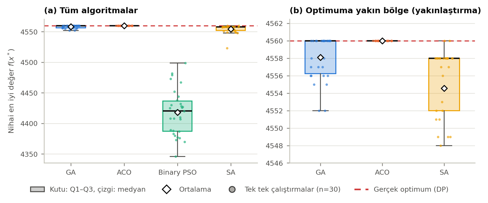<br>
  <sub>Nihai değerlerin dağılımı: (a) tüm algoritmalar, (b) optimuma yakın bölge.</sub>
</p>

<p align="center">
  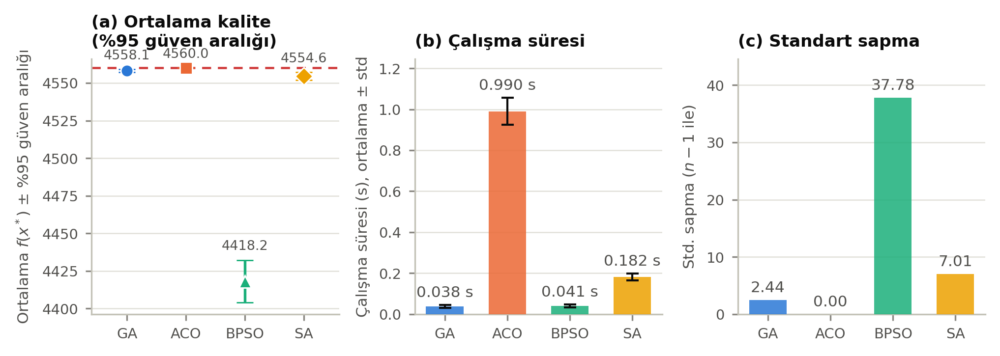<br>
  <sub>(a) Ortalama kalite ± %95 güven aralığı, (b) çalışma süresi (medyan-of-3), (c) standart sapma.</sub>
</p>

> Bu bulgular **tek ve görece kolay bir örneğe** aittir (açgözlü sezgisel bile %0.18 yakındır; DP aynı örneği
> milisaniyelerde kesin çözer). Meta-sezgiseller burada bir karşılaştırma vasıtasıdır.

## Öne çıkan bulgular

<p align="center">
  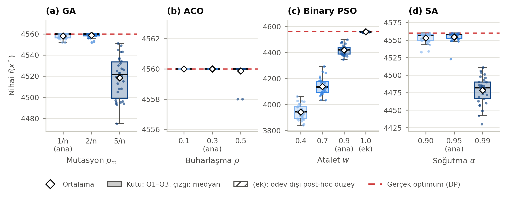<br>
  <sub><b>Parametre duyarlılığı.</b> Binary PSO'da atalet büyüdükçe sonuç iyileşir (w = 1.0 ile 4558.17 ± 2.00, GA düzeyi);
  GA'da 5/n mutasyon, SA'da α = 0.99 belirgin kayıp yaratır; ACO ρ'ya duyarsızdır.</sub>
</p>

<p align="center">
  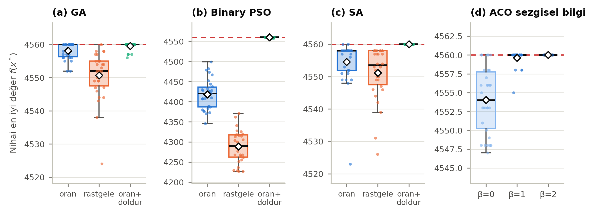<br>
  <sub><b>Kısıt yönetimi algoritma seçiminden daha belirleyici.</b> Oran sırasıyla dolduran onarımla SA 4560.00, Binary PSO 4559.83'e çıkar;
  ACO'da sezgisel bilgi kapatılınca (β = 0) ortalama 4554.03'e düşer. ACO üstünlüğü kısmen <i>bilgi</i> avantajıdır.</sub>
</p>

<p align="center">
  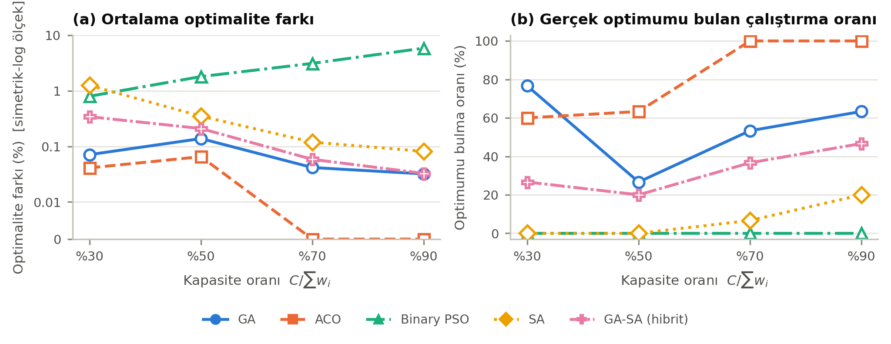<br>
  <sub><b>Sıralama kapasite oranına bağlı.</b> ACO %30–%50 kapasitede optimumu her seferinde bulamaz (%60–%63); GA-SA hibriti
  düşük kapasitelerde GA'dan kötüdür. Tek bir orandan çıkan sonuç genellenemez.</sub>
</p>

## Rapor önizlemesi

Türkçe akademik rapor (10 sayfa): [`reports/final_report.pdf`](reports/final_report.pdf)

<p align="center">
  <a href="reports/final_report.pdf">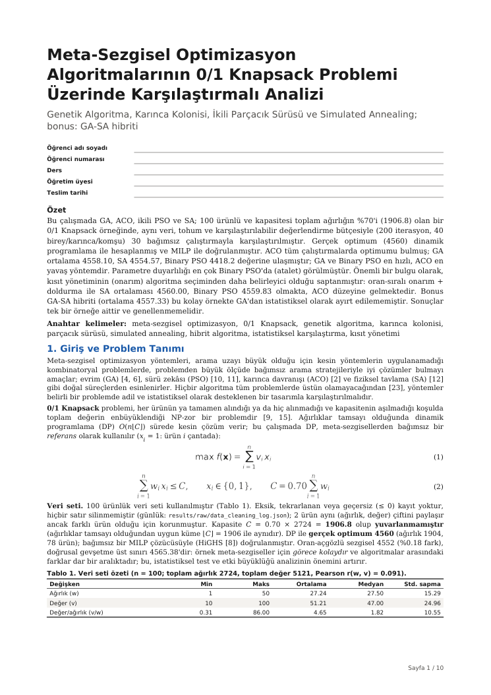</a>
  <a href="reports/final_report.pdf">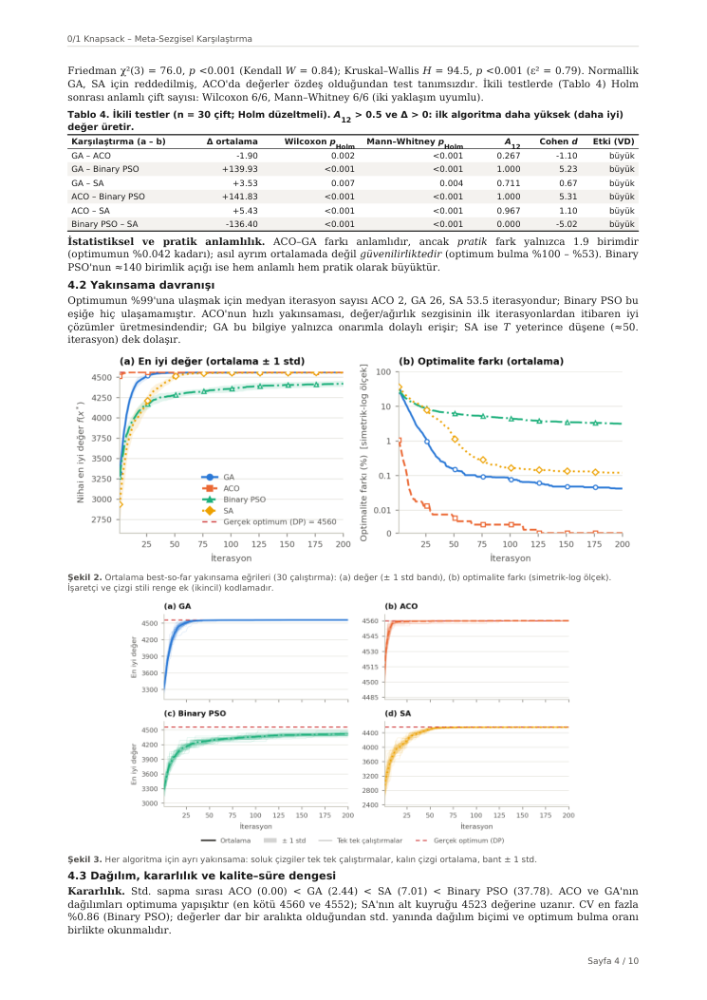</a>
  <a href="reports/final_report.pdf">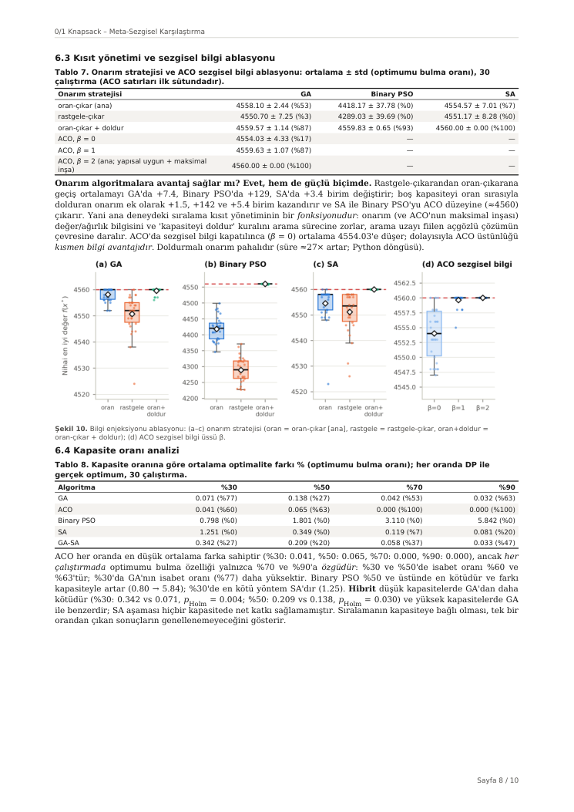</a>
</p>

## Hızlı başlangıç

Python ≥ 3.10 önerilir (geliştirme/sonuçlar: Python 3.11.0).

```bash
python -m venv .venv
.venv\Scripts\activate          # Windows;  Linux/macOS: source .venv/bin/activate
pip install -r requirements.txt
```

Tüm hat (testler → veri analizi → pilot → ana deney → duyarlılık → ek deneyler → istatistik → grafikler → PDF rapor):

```bash
python main.py
```

Toplam süre kabaca 25–35 dakikadır (en yavaş bileşen ACO'dur ve süre ölçümü 3 tekrar içerir); süreler makineye bağlıdır.

<details>
<summary><b>Aşamaları tek tek çalıştırmak</b></summary>

```bash
python main.py --stage tests          # birim testleri
python main.py --stage data           # veri seti analizi, referans optimum (DP + MILP)
python main.py --stage pilot          # ana konfigürasyonun pilot seçimi (raporlanmayan tohumlarla)
python main.py --stage benchmark      # ana deney (GA, ACO, BPSO, SA) + GA-SA hibriti
python main.py --stage sensitivity    # parametre duyarlılığı
python main.py --stage extras         # eşit bütçe, ablasyonlar, kapasite oranları
python main.py --stage stats          # istatistik tabloları
python main.py --stage figures        # grafikler
python main.py --stage report         # reports/final_report.pdf
```

Hızlı duman testi (3 çalıştırma, 30 iterasyon; gerçek sonuçları **ezmez**, `results_quick/` kullanır):

```bash
python main.py --quick --skip-tests
```

Ham sonuçlar korunarak yalnızca grafik ve raporu yeniden üretmek için:

```bash
python main.py --stage figures
python main.py --stage report
```

</details>

Bir algoritmayı doğrudan kullanmak:

```python
from core.data_loader import build_problem
from algorithms import GeneticAlgorithm

problem, _, _ = build_problem("data/dataset.csv", capacity_ratio=0.70)
result = GeneticAlgorithm(problem, population_size=40, mutation_probability=0.02,
                          max_iterations=200).run(seed=2000)
print(result.best_value, result.total_weight, result.n_selected, result.n_evaluations)
```

Her `run(seed)` çağrısı en iyi çözüm vektörünü, amaç değerini, toplam ağırlığı, seçilen ürün sayısını,
*best-so-far* yakınsama geçmişini, süreyi ve nesne fonksiyonu değerlendirme sayısını döndürür.

## Parametreleri değiştirme

Her şey `config.py` içindedir:

| Ne | Nerede |
|---|---|
| İterasyon sayısı, popülasyon/sürü/karınca sayısı, çalıştırma sayısı | `ITERATIONS`, `POPULATION_SIZE`, `N_RUNS` |
| Süre ölçümü tekrar sayısı (medyan) | `TIMING_REPEATS` |
| Önceden tanımlı tohumlar (raporlanan) / pilot tohumlar | `SEEDS`, `PILOT_SEEDS` |
| Kapasite oranı | `CAPACITY_RATIO` (0.70), `CAPACITY_RATIOS` (bonus) |
| Algoritma parametreleri | `main_parameters(n_items)` |
| Duyarlılık ızgaraları | `sensitivity_grids(n_items)` |

## Tekrarlanabilirlik ve doğruluk

- **Rastgelelik:** `numpy.random.default_rng(seed)`; tohumlar `config.SEEDS` içindedir ve `results/raw/run_metadata.json`
  dosyasına kaydedilir. Aynı algoritma + parametre + tohum **birebir aynı sonucu** üretir (ana deney sıfırdan yeniden
  koşulduğunda 150 çalıştırmanın çözüm vektörleri bit düzeyinde aynı çıkmıştır).
- **Süre ölçümü protokolü:** her (algoritma, tohum) çifti `config.TIMING_REPEATS` (=3) kez art arda koşturulur, süre
  olarak **medyan** alınır ve üç tekrarın aynı çözümü verdiği otomatik denetlenir. İlk tek-geçişli ölçüm, makine
  yüklüyken 2.6–3.2× daha yüksek süreler vermiştir (`results/raw/timing_first_pass.csv`); algoritmalar arası oranlar korunmuştur.
- **Ayrı kayıtlar:** ana karşılaştırma, parametre duyarlılığı, bonus ve ek deneyler farklı dosyalardadır
  (`main_*`, `sensitivity_*`, `bonus_*`, `extra_*`).
- **Testler:** `python -m pytest` — 133 test; DP/MILP'in brute-force ile uyumunu, onarımın uygunluğunu, her algoritmanın
  uygun çözüm ürettiğini, FE sayısı formüllerini, tohum tekrarlanabilirliğini, GA operatörlerini, Metropolis kabulünü,
  sigmoid dönüşümünü ve ACO feromon güncellemesini denetler. Testlerin gücü, kasıtlı eklenen 11 farklı hata ile
  (mutasyon testi) ölçülmüş ve hepsi yakalanmıştır.

## Proje yapısı

<details>
<summary><b>Dizin ağacı</b></summary>

```
├── data/dataset.csv                 # 100 ürünlük veri seti
├── core/                            # ortak altyapı
│   ├── knapsack.py                  #   problem sınıfı (kapasite = oran × toplam ağırlık)
│   ├── constraints.py               #   onarım (repair) stratejileri
│   ├── fitness.py                   #   sayaçlı ortak nesne fonksiyonu (FE sayımı)
│   ├── exact.py                     #   DP, MILP, brute-force, LP üst sınırı, açgözlü
│   └── data_loader.py               #   yükleme, temizleme günlüğü, betimsel istatistik
├── algorithms/                      # aynı arayüz: Algoritma(problem, **param).run(seed)
│   ├── genetic_algorithm.py         #   GA
│   ├── ant_colony.py                #   ACO (ürün-feromonlu, MAX–MIN tarzı)
│   ├── binary_pso.py                #   Binary PSO (sigmoid transfer)
│   ├── simulated_annealing.py       #   SA (bit-flip + swap, Metropolis)
│   └── hybrid_ga_sa.py              #   GA-SA hibriti (bonus)
├── experiments/
│   ├── runner.py                    #   ortak çalıştırıcı (serpiştirilmiş tohumlar, ısınma, doğrulama)
│   ├── pilot_selection.py           #   ana konfigürasyonun pilot tohumlarla seçimi
│   ├── benchmark.py                 #   ana deney (+ hibrit koşusu)
│   ├── parameter_sensitivity.py     #   parametre duyarlılığı
│   ├── extra_experiments.py         #   eşit bütçe, onarım/ACO ablasyonu, hibrit payı, kapasite oranları
│   ├── statistical_analysis.py      #   özet tablolar, güven aralıkları, Friedman/Wilcoxon, Holm, etki büyüklüğü
│   └── dataset_analysis.py          #   veri seti istatistikleri
├── visualization/{style,plots}.py   # tüm grafikler (PNG 300 dpi + PDF)
├── reports/                         # Türkçe akademik PDF raporu (build_report.py + bölüm modülleri)
├── tests/                           # birim testleri (brute-force doğrulamalı)
├── docs/                            # savunma rehberi, git adımları, README görselleri
├── results/{raw,tables,figures}/    # ham koşular, tablolar, grafikler
├── config.py                        # tüm parametreler, tohumlar, yollar (tek merkez)
├── main.py                          # komut satırı girişi
└── requirements.txt
```

</details>

## PDF rapor ve belgeler

- `python main.py --stage report` komutu `reports/final_report.pdf` dosyasını üretir (ReportLab; fontlar matplotlib
  ile gelen DejaVu ailesidir, ek kurulum gerekmez). Kapaktaki öğrenci bilgileri
  `reports/sections_static.py` içindeki `STUDENT_INFO` sözlüğünden düzenlenir.
- [`docs/SAVUNMA_REHBERI.md`](docs/SAVUNMA_REHBERI.md) — sunum akışı, algoritmaların jüri diliyle anlatımı, hazır soru–cevaplar.
- [`docs/GIT_ADIMLARI.md`](docs/GIT_ADIMLARI.md) — aşama aşama commit planı.
